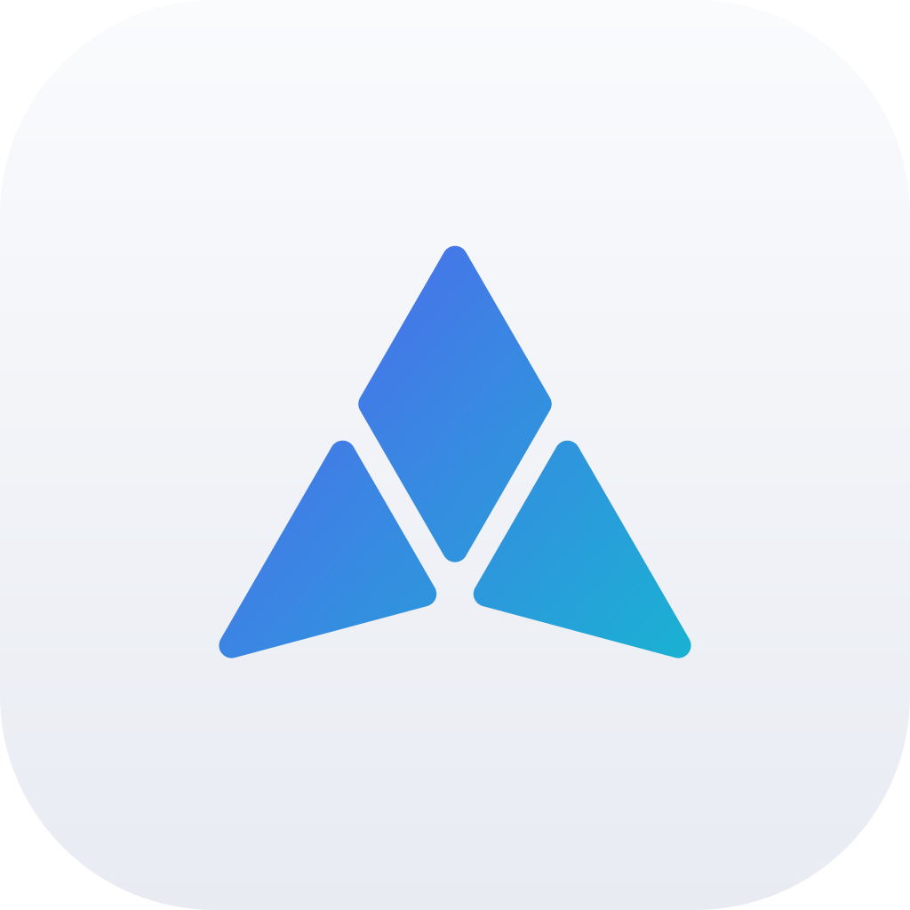
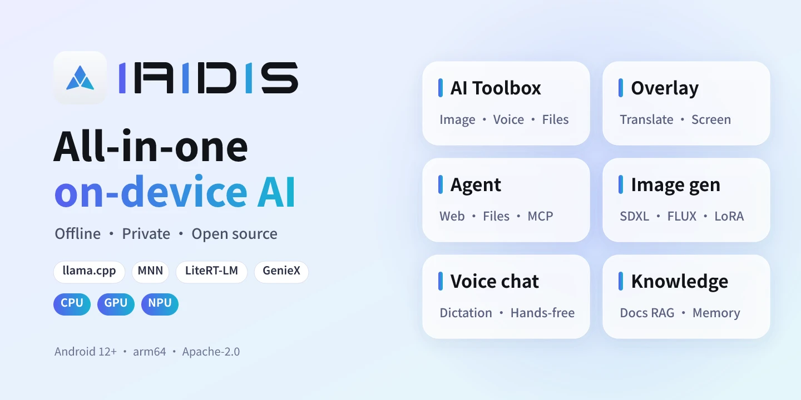

<p align="center"><a href="README.md">中文</a> | <b>English</b></p>

<p align="center">
  <picture>
    <source media="(prefers-color-scheme: dark)" srcset="docs/assets/icon-dark.png">
    
  </picture>
</p>

<p align="center">
  <picture>
    <source media="(prefers-color-scheme: dark)" srcset="docs/assets/wordmark-dark.svg">
    
  </picture>
</p>

<p align="center">
  <b>All-in-one on-device AI for Android</b><br/>
  Offline · Private · Open source
</p>

<p align="center">
  <a href="https://github.com/WWRJ3321/IRIDIS/releases/latest"><b>Download APK</b></a> ·
  <a href="docs/BUILD.md">Build</a> ·
  <a href="docs/API.md">API</a> ·
  <a href="docs/ARCHITECTURE.md">Architecture</a> ·
  <a href="CHANGELOG.md">Changelog</a> ·
  <a href="#community">Community</a>
</p>

<p align="center">
  
  <a href="LICENSE"></a>
  <a href="https://github.com/WWRJ3321/IRIDIS/releases/latest"></a>
</p>

<p align="center"></p>

---

## What's new in 3.0.0

- **AI Toolbox** (sidebar): image generation, floating bubble, text-to-speech, speech-to-text and file finder, one tile each
- **Floating bubble**: a small bubble on the screen edge for on-screen translation (overlaid on the original text), screen reading and Ask AI (with your clipboard) over any app; tucks into the edge when idle, drag to the bottom to close
- **Dynamic Island**: download, image and model-loading progress in the bottom-left corner; finished images pop up large
- **Arrange your home screen**: Settings › Home layout, drag the home buttons into place
- **Better image generation**: sizes suggested per model, one-tap prompt cleanup; zoomable viewer with 2×/4× HD upscaling; take photos straight from chat attachments
- **One-step setup**: download a recommended model in one tap, loaded automatically when done
- **Editable prompts**, **Liquid Glass** style, home-screen widget and app shortcuts, hands-free voice chat, word-by-word dictation

Full history in the [CHANGELOG](CHANGELOG.md) (Chinese). The story behind IRIDIS: [docs/STORY.md](docs/STORY.md) (Chinese).

## Highlights

| Feature | Details |
|:--|:--|
| **Four inference engines** | llama.cpp · MNN · LiteRT-LM · GenieX (GGUF on Qualcomm NPU), plus a bundled Hexagon runtime; picks the fastest of CPU / GPU / NPU per device |
| **Fully offline** | Inference, voice, image generation and history stay on the phone; works in airplane mode |
| **Agent** | Read and write files, web search and page reading, local image generation, calculator, remote MCP tools, undoable changes; GUI agent (beta) can operate your phone |
| **Local image generation** | GPU / CPU (stable-diffusion.cpp): SD1.5, SDXL, SD3.5, FLUX.1 and more, with automatic file detection on import; Snapdragon NPU: SD1.5 and Anima packages. LoRA, live preview, keeps running in the background |
| **Character cards** | Import / export SillyTavern V2/V3 cards (PNG / JSON / CHARX), switchable greetings, keyword-triggered lorebooks, per-card model and voice |
| **Memory & knowledge base** | Long-term memory; local document retrieval (folders, edits, pasted text, large files and GBK encoding); editable messages and multi-version regeneration |
| **Local voice & translation** | Offline speech recognition (live dictation) and TTS (or system TTS), hands-free voice chat; local translation (current model or Bergamot offline packs) |
| **Model downloads** | Curated list, online GGUF search, auto source selection (ModelScope / hf-mirror / Hugging Face), import from file; GGUF + mmproj for vision |
| **LAN API** | OpenAI / Ollama compatible; your phone is the model server |
| **Tuned for phones** | KV cache reuse, thermal throttling and overheat stop, idle unload, automatic fallbacks on low-memory devices |
| **More** | 7 UI languages, chat text size, settings export / import, HTML / Three.js preview, history trash, storage cleanup |

## Quick start

1. Install the APK from [Releases](https://github.com/WWRJ3321/IRIDIS/releases/latest)
2. Model menu › "Models & loading" › "Download models": pick from the list, search GGUF online, or import a file
3. Start chatting; turn on "Agent" for tools, and find the rest in the sidebar's "AI Toolbox"

**Requirements**: Android 12+, arm64; Snapdragon 8 Gen 1 or newer recommended; 12 GB RAM recommended for models above 4B. The floating bubble needs the "display over other apps" permission; screen reading needs the IRIDIS accessibility service.

> [!NOTE]
> Upgrading from IRIS LocalAI: since 2.1.0 the package name is `com.iridis`, so it cannot install over the old app. Export a backup in the old version, then import it in Settings › Storage › Backup & restore.

## Engines

| Engine | Format | Hardware |
|---|---|---|
| llama.cpp | `.gguf` (with mmproj for vision) | CPU · GPU (OpenCL) · NPU (bundled Hexagon runtime, beta) |
| GenieX | `.gguf` | Qualcomm NPU (runtime downloaded in app) |
| MNN-LLM | MNN model folder | CPU · GPU (OpenCL) |
| LiteRT-LM | `.litertlm` | GPU · Qualcomm NPU |

- LiteRT on NPU needs a Snapdragon 8-series chip and the QNN runtime, downloaded in app after accepting Qualcomm's license.
- GGUF on NPU: GenieX first when present; otherwise the bundled llama.cpp Hexagon runtime (HTP v73+, i.e. Snapdragon 8 Gen 2 and newer), unpacked on first use; falls back to GPU / CPU if both fail. Not verified on every device.
- Q1_0 / Q2_0 low-bit GGUF (e.g. PrismML Bonsai) runs on CPU / GPU only; PrismML-only PQ2_0 / PTQ1_0 are not supported and the app suggests Q2_0 instead.

## Local API

Enable in Settings › API server. Listens on localhost by default; LAN access must be turned on manually and requires an API key.

```bash
curl http://127.0.0.1:8686/v1/chat/completions \
  -H "Content-Type: application/json" \
  -d '{"messages":[{"role":"user","content":"Hello"}]}'
```

## Privacy

Chats, memory and files stay on the device, and cloud backup is disabled. The app goes online only to download models / voice packs / translation packs / runtimes (sources are speed-tested first), for agent web search or page reading, for remote MCP servers you add, and when the API is enabled.

## Build

```bash
sh scripts/fetch-deps.sh
cp local.properties.example local.properties   # set sdk.dir / ndk.path
./gradlew assembleFullRelease                  # llama.cpp only: assembleLiteRelease
```

JDK 17 · Android SDK 36 · NDK r27c+ · CMake. See [docs/BUILD.md](docs/BUILD.md).

## Community

QQ group "WWRJ的小窝": **1106294553**, for bug reports, ideas and chat. Or open a [GitHub Issue](https://github.com/WWRJ3321/IRIDIS/issues).

## License

[Apache-2.0](LICENSE). Third-party components: [THIRD_PARTY_NOTICES.md](THIRD_PARTY_NOTICES.md). The QNN runtime is proprietary Qualcomm software and is not distributed with the source; parts of the image-generation native library derive from Local Dream (CC BY-NC 4.0, non-commercial); some optional voice models are non-commercial only.

> AI output can be wrong; do not rely on it for medical, legal or financial decisions. The agent can go online and change workspace files, and the GUI agent and screen reading can read or operate the screen; enable them only for content you trust.

UI languages: 简体中文, 繁體中文, English, 日本語, Deutsch, Español, हिन्दी.
