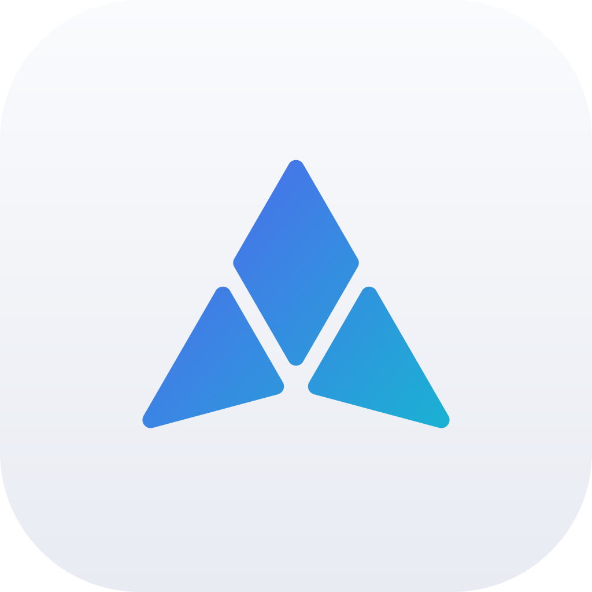
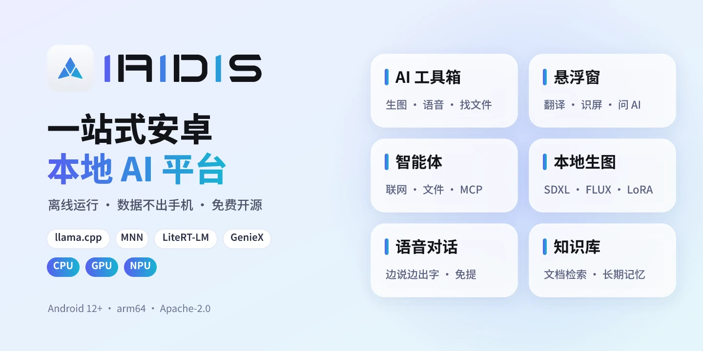

<p align="center"><b>中文</b> | <a href="README.en.md">English</a></p>

<p align="center">
  <picture>
    <source media="(prefers-color-scheme: dark)" srcset="docs/assets/icon-dark.png">
    
  </picture>
</p>

<p align="center">
  <picture>
    <source media="(prefers-color-scheme: dark)" srcset="docs/assets/wordmark-dark.svg">
    
  </picture>
</p>

<p align="center">
  <b>一站式安卓本地 AI 平台</b><br/>
  离线运行 · 数据不出手机 · 免费开源<br/>
  <sub>All-in-one on-device AI for Android. Offline, private, open source.</sub>
</p>

<p align="center">
  <a href="https://github.com/WWRJ3321/IRIDIS/releases/latest"><b>下载 APK</b></a> ·
  <a href="docs/BUILD.md">构建</a> ·
  <a href="docs/API.md">API</a> ·
  <a href="docs/ARCHITECTURE.md">架构</a> ·
  <a href="CHANGELOG.md">更新日志</a> ·
  <a href="docs/STORY.md">IRIDIS的故事</a> ·
  <a href="#交流">QQ 群</a>
</p>

<p align="center">
  
  <a href="LICENSE"></a>
  <a href="https://github.com/WWRJ3321/IRIDIS/releases/latest"></a>
  <a href="#交流"></a>
</p>

<p align="center"></p>

---

## 3.0.0 新在哪

- **AI 工具箱**（侧栏）：生图、悬浮窗、文本转语音、语音转文本、找文件，一格一个
- **悬浮窗**：屏幕边的小球，在任何应用上屏幕翻译（译文盖在原文上）、识屏、问 AI（带上剪贴板）；闲置贴边半隐，拖到底部关闭
- **灵动岛**：下载、生图、加载模型的进度显示在左下角，生图完成弹出大图
- **主页布局随你摆**：设置 › 主页布局，拖动排列主页按钮
- **生图更好用**：尺寸按模型给出，提示词一键整理；看图页可缩放，可高清放大 2×/4×；对话附件可直接拍照
- **一步上手**：推荐模型一键下载，下完自动加载
- **可自定提示词**、**液态玻璃**界面风格、桌面小组件与图标快捷方式、语音聊天免提、语音输入逐字打出

完整记录见 [CHANGELOG](CHANGELOG.md)。

## 亮点

| 能力 | 说明 |
|:--|:--|
| **四种推理引擎** | llama.cpp · MNN · LiteRT-LM · GenieX（高通 NPU 跑 GGUF），另有内置 Hexagon 运行库；CPU / GPU / NPU 按机型选最快 |
| **完全离线** | 推理、语音、生图、记录都在本机，飞行模式照常可用 |
| **智能体** | 读写文件、联网搜索与读网页、本地生图、计算器、远程 MCP 工具，改动可撤销；GUI 智能体（测试）可代你操作手机 |
| **本地生图** | GPU / CPU（stable-diffusion.cpp）：SD1.5、SDXL、SD3.5、FLUX.1 等，导入时自动识别文件用途；骁龙 NPU：SD1.5 与 Anima 包。支持 LoRA、实时预览、切后台继续生成 |
| **角色卡** | 导入 / 导出 SillyTavern V2/V3 角色卡（PNG / JSON / CHARX），开场白可切换，内置世界书按关键词触发，可绑定模型和音色 |
| **记忆与知识库** | 长期记忆；本地文档检索（文件夹、编辑、粘贴文字，大文本与 GBK 编码）；消息可编辑、可多版本重新生成 |
| **本地语音与翻译** | 离线识别（边说边出字）与合成（也可用系统 TTS），免提语音聊天；本地翻译（当前模型或 Bergamot 离线包） |
| **模型下载** | 推荐列表、在线搜索 GGUF、魔搭 / hf-mirror / Hugging Face 自动选源，可从文件导入；GGUF 配 mmproj 可看图 |
| **局域网 API** | OpenAI / Ollama 兼容，手机就是模型服务器 |
| **为手机调校** | KV 缓存复用、温度限速与过热停止、空闲卸载、低内存机型自动收敛 |
| **更多** | 7 种界面语言、对话文字大小、设置导出 / 导入、HTML / Three.js 预览、历史回收站、存储空间清理 |

## 快速开始

1. 从 [Releases](https://github.com/WWRJ3321/IRIDIS/releases/latest) 安装 APK
2. 首页模型菜单 ›「模型与加载」›「下载模型」：从推荐列表下载、在线搜索 GGUF，或从文件导入
3. 开聊；需要工具时打开「智能体」，其余功能在侧栏「AI 工具箱」

**要求**：Android 12+、arm64，建议骁龙 8 Gen 1 及以上；4B 以上模型建议 12 GB 内存。悬浮窗需「显示在其他应用上层」权限，识屏需开 IRIDIS 无障碍。

> [!NOTE]
> 从 IRIS LocalAI 升级：2.1.0 起包名改为 `com.iridis`，不能覆盖安装。先在旧版导出备份，装新版后在 设置 › 存储 › 备份与恢复 导入。

## 引擎

| 引擎 | 格式 | 硬件 |
|---|---|---|
| llama.cpp | `.gguf`（可配 mmproj 看图） | CPU · GPU (OpenCL) · NPU（内置 Hexagon 运行库，测试） |
| GenieX | `.gguf` | 高通 NPU（App 内下载运行库） |
| MNN-LLM | MNN 模型文件夹 | CPU · GPU (OpenCL) |
| LiteRT-LM | `.litertlm` | GPU · 高通 NPU |

- LiteRT 的 NPU 需骁龙 8 系芯片，并在 App 内同意高通许可后下载 QNN 运行库。
- GGUF 走 NPU：有 GenieX 时先用 GenieX，失败或没有时用 APK 内置的 llama.cpp Hexagon 运行库（HTP v73 及以上，即骁龙 8 Gen 2 起），首次使用自动解压；仍失败则回退 GPU / CPU。均未在所有机型上验证。
- Q1_0 / Q2_0 低比特 GGUF（如 PrismML Bonsai）只走 CPU / GPU；PrismML 专用的 PQ2_0 / PTQ1_0 不支持，会提示改下 Q2_0。

## 本地 API

设置 › API 服务 中开启。默认只监听本机；开放局域网须手动开启并使用 API Key。

```bash
curl http://127.0.0.1:8686/v1/chat/completions \
  -H "Content-Type: application/json" \
  -d '{"messages":[{"role":"user","content":"你好"}]}'
```

## 隐私

对话、记忆和文件只存于本机，禁止云备份。仅在这些情况下联网：下载模型 / 语音包 / 翻译包 / 运行库（下载前会对下载源测速）、智能体联网搜索或读网页、使用你添加的远程 MCP 服务、开启 API。

## 构建

```bash
sh scripts/fetch-deps.sh
cp local.properties.example local.properties   # 填 sdk.dir / ndk.path
./gradlew assembleFullRelease                  # 仅 llama.cpp：assembleLiteRelease
```

JDK 17 · Android SDK 36 · NDK r27c+ · CMake。详见 [docs/BUILD.md](docs/BUILD.md)。

## 故事

为什么要做 IRIDIS、名字和标志从哪来、一路走来的版本：[IRIDIS的故事](docs/STORY.md)。

## 交流

QQ 群「WWRJ的小窝」：**1106294553**，反馈 bug、提建议、闲聊都欢迎，群里 @Q群管家 可查常见问题。也可以提 [GitHub Issue](https://github.com/WWRJ3321/IRIDIS/issues)。

## 许可证

[Apache-2.0](LICENSE)。第三方组件见 [THIRD_PARTY_NOTICES.md](THIRD_PARTY_NOTICES.md)；QNN 运行库为高通专有软件，不随源码分发；生图原生库部分源自 Local Dream（CC BY-NC 4.0，非商业）；部分可选语音模型仅限非商业使用。

> AI 输出可能出错，请勿用于医疗、法律、金融等重要决策。智能体可联网、改动工作区文件，GUI 智能体与识屏可读取或操作屏幕，请只对信任的内容开启。

界面语言：简体中文、繁體中文、English、日本語、Deutsch、Español、हिन्दी。
